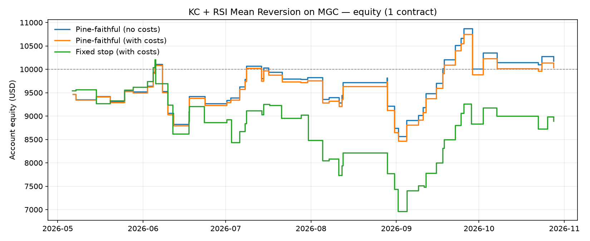

# KC + RSI Mean Reversion on Micro Gold, backtested with Databento

## Results — MGC, 30-minute bars, 1 May – 1 Nov 2026

| Run | Trades | Win rate | Net profit | Profit factor | Max drawdown |
|---|---|---|---|---|---|
| Pine-faithful, no costs | 51 | 58.8% | $180 | 1.03 | $1,544 |
| Pine-faithful, with costs | 51 | 58.8% | $42 | 1.01 | $1,616 |
| Fixed stop, with costs | 50 | 58.0% | −$1,110 | 0.84 | $3,238 |

One contract. "With costs" = $0.62 commission per side + 1 tick slippage.



**Takeaways**
- Roughly breakeven over this period, so no meaningful edge on 30-minute bars once costs are included.
- Shorts carried the strategy (71% win rate, +$1,869 after costs) while longs lost $1,827.
- The Pine script recalculates its stop every bar. Locking the stop at entry instead hit more targets but produced larger losses and double the drawdown.
- Databento flagged 24 May 2026 as a degraded-quality day. One day out of six months doesn't materially affect these results.
- 51 trades is a small sample, so none of this is statistically conclusive.

A Python port of my TradingView (Pine Script v6) strategy, backtested on CME
micro gold futures (MGC) using historical data from
[Databento](https://databento.com).

The strategy fades moves outside a Keltner Channel when RSI is stretched and
the market isn't trending:

| Rule | Long | Short |
|---|---|---|
| Entry | Close below lower KC band **and** RSI < 30 **and** ADX < 25 | Close above upper KC band **and** RSI > 70 **and** ADX < 25 |
| Target | KC basis (20 EMA) | KC basis |
| Stop | Same distance from price as the target × Risk Reward | Same |

Defaults: KC 20 / 2.0, RSI 14, ADX 14 (max 25), Risk Reward 1.0, 30-minute bars.

## Quick start

```bash
pip install -r requirements.txt

# 1. Get an API key from the Databento portal and export it
export DATABENTO_API_KEY=db-xxxxxxxx

# 2. Download 1-minute MGC bars (shows the cost and asks before downloading)
python scripts/fetch_data.py --start 2026-05-01 --end 2026-11-01

# 3. Run the backtest (resamples to 30-minute bars)
python scripts/run_backtest.py
```

No API key yet? `python scripts/run_backtest.py --synthetic` runs the whole
pipeline on random-walk data so you can see the outputs.

Results go to `output/`: `summary.json`, a trades CSV per run,
`equity_curve.png` and `recent_trades.png`.

Useful options:

```bash
python scripts/run_backtest.py --timeframe 15min      # different chart timeframe
python scripts/run_backtest.py --adx-tf 4h            # ADX on a higher timeframe
python scripts/run_backtest.py --rr 1.5               # Risk Reward input
python scripts/run_backtest.py --commission 0.62 --slippage 1
```

## What each run means

The backtest runs three versions side by side:

1. **Pine-faithful (no costs)**: replicates the Pine script's logic with
   TradingView's default settings (no commission, no slippage).
2. **Pine-faithful (with costs)**: same, plus commission per side and slippage
   in ticks on market entries and stop fills.
3. **Fixed stop (with costs)**: the stop is locked in on the signal bar instead
   of being recalculated every bar (see below).

## Porting notes

Things I had to handle carefully to replicate TradingView's behaviour in Python:

- **Indicator seeding.** Pine's `ta.ema` and `ta.rma` start from a simple moving
  average of the first N values. pandas' `ewm()` doesn't, so the indicators
  are hand-written in `kcrsi/indicators.py`.
- **Fill timing.** `strategy.entry()` is a market order evaluated on the bar
  close, so it fills at the **next** bar's open.
- **The moving stop.** The Pine script calls `strategy.exit()` on every bar
  using the *current* close, so the stop is recalculated each bar rather than
  fixed at entry. The `fixed_stop` option in `Params` tests the alternative.
- **Stop and target on the same bar.** TradingView assumes O→H→L→C if the high
  is closer to the open, otherwise O→L→H→C. The engine does the same.
- **Higher-timeframe ADX** only uses a higher-timeframe bar once it has closed
  (like `request.security` with `lookahead_off`), and there's a test proving
  future data doesn't leak in.

## Data notes

- Dataset `GLBX.MDP3` (CME Globex), schema `ohlcv-1m`, resampled locally to
  30 minutes. Databento only emits a bar when there's a trade in that minute.
- Default symbol `MGC.v.0` is a continuous contract that follows the most
  actively traded expiry. It is **not back-adjusted**, so prices can jump at a
  roll. The backtest prints the roll dates so you can check any odd trades.
- 4-hour and daily bars may differ slightly from TradingView, which anchors
  them to the CME session open (17:00 Chicago).

## Limitations

- One contract, no position sizing, no session or news filters.
- Backtests on a few months of data are a sanity check, not proof of an edge.
- Results haven't been reconciled trade-by-trade against TradingView's
  Strategy Tester, so small differences are possible (data source, roll
  handling, bar alignment).

## Project layout

```
kcrsi/indicators.py   EMA, RMA, ATR, RSI, Keltner, ADX (Pine-matched)
kcrsi/strategy.py     signals + bar-by-bar backtest engine
kcrsi/metrics.py      Strategy Tester-style stats
kcrsi/data.py         Databento download, cost estimate, resampling
scripts/              fetch_data.py, run_backtest.py
tests/                pytest suite (python -m pytest)
```
